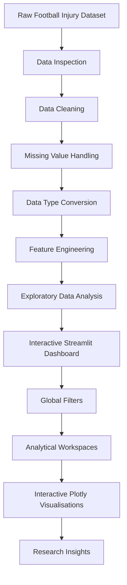

<div align="center">


<br/>

# FOOTLENS
### Beyond the game. Behind the numbers.

**An Interactive Football Injury Analytics & Team Performance Intelligence Platform**

[](https://streamlit.io/)
[](https://www.python.org/)
[](https://pandas.pydata.org/)
[](https://plotly.com/)
[](#academic-context)

<br/>

<a href="https://aqtnempbf732rathodjas.streamlit.app/">

</a>

<br/>
<br/>


<br/>

*Turning injury records into meaningful football intelligence.*

</div>

<details>
<summary><b>Jump to a section</b></summary>

<br/>

| | | |
|---|---|---|
| [01 — Project Overview](#01--project-overview) | [08 — Visualisation & Analytical Techniques](#08--visualisation--analytical-techniques) | [15 — Installation & Local Setup](#15--installation--local-setup) |
| [02 — Problem Statement](#02--problem-statement) | [09 — Global Filters](#09--global-filters) | [16 — Deployment](#16--deployment) |
| [03 — Research Questions](#03--research-questions) | [10 — Technology Stack](#10--technology-stack) | [17 — Limitations & Considerations](#17--limitations--considerations) |
| [04 — Dataset & Research Scope](#04--dataset--research-scope) | [11 — System Architecture](#11--system-architecture) | [18 — Future Improvements](#18--future-improvements) |
| [05 — Data Preprocessing & Cleaning](#05--data-preprocessing--cleaning) | [12 — Interface & Design Philosophy](#12--interface--design-philosophy) | [19 — Academic Context](#19--academic-context) |
| [06 — Exploratory Data Analysis](#06--exploratory-data-analysis) | [13 — Project Structure](#13--project-structure) | [20 — Conclusion](#20--conclusion) |
| [07 — Interactive Dashboard](#07--interactive-dashboard) | [14 — Dashboard Screenshots](#14--dashboard-screenshots) | |

</details>

---


## 01 — Project Overview

Football performance depends on more than the players available on matchday. Injuries can disrupt team selection, affect player availability, influence match outcomes and create challenges for clubs throughout a season.

However, injury records are often viewed as isolated medical events. FootLens approaches the problem from a broader analytical perspective: **how can player injury data be explored to understand recovery patterns and investigate potential relationships between player absences and team performance?**

FootLens is an interactive football injury analytics platform developed using Python, Pandas, Streamlit and Plotly. It transforms structured injury records into an accessible analytical environment through data preprocessing, exploratory data analysis, feature engineering and interactive visualisation.

The dashboard allows users to investigate injury frequency, player availability, recovery duration, club-level patterns and changes in team performance around injury periods.

### The central objective

To develop a data-driven dashboard that helps users explore football injury patterns and examine how player absences relate to team performance across different clubs and seasons.


## 02 — Problem Statement

Football clubs operate in an environment where player availability is an important part of squad management. An injury may affect a player's participation, alter team selection and coincide with changes in a club's results.

The challenge is to organise injury records into meaningful information that can answer questions such as:

- Which injuries appear most frequently?
- Which positions experience the greatest injury burden?
- How do recovery durations differ between injury categories?
- Are some age groups associated with longer recovery periods?
- How does team performance differ before, during and after player absences?

Without structured analysis, identifying these patterns across multiple seasons can be difficult.

**FootLens addresses this challenge by combining data cleaning, analytical calculations and interactive visualisation in one platform.**


## 03 — Research Questions

The project is guided by ten research questions. Each question connects a real football analytics problem to a specific analytical approach and dashboard output.

| No. | Research question | Analytical approach |
|---|---|---|
| 01 | Which clubs experience the highest number of recorded player injuries across the available seasons? | Club-wise grouping, aggregation and ranking |
| 02 | Which injury types occur most frequently, and how does their distribution vary? | Injury classification and frequency analysis |
| 03 | Which playing positions experience the greatest injury burden? | Position-wise injury counts and comparisons |
| 04 | How does player age relate to injury frequency and recovery duration? | Age grouping, distribution analysis and comparison |
| 05 | Which injury categories are associated with the longest recorded recovery periods? | Recovery-duration aggregation and ranking |
| 06 | How do injury patterns change across the five recorded seasons? | Season-wise trend analysis and timeline visualisation |
| 07 | How does a club's performance differ before and during a player's recorded absence? | Pre-injury and absence-period performance comparison |
| 08 | Is there an observable relationship between recovery duration and team performance change? | Correlation exploration and scatter analysis |
| 09 | Which players demonstrate notable recovery and comeback patterns in the available records? | Player-level aggregation and comeback leaderboard |
| 10 | How do injury frequency, recovery duration and performance indicators differ between clubs? | Multi-variable club comparison and pivot tables |

### Research objectives

The ten questions are translated into five broader objectives:

1. **Identify injury patterns:** Understand the distribution of injuries by club, player, season, position and category.
2. **Investigate recovery:** Explore recovery durations and compare the recovery characteristics of different injury groups.
3. **Examine player availability:** Understand how recorded absences are distributed across players and teams.
4. **Analyse team performance:** Compare available performance indicators before and during injury-related absences.
5. **Communicate findings:** Present analytical results through interactive visualisations that allow users to investigate patterns independently.


## 04 — Dataset & Research Scope

FootLens uses a structured football injury dataset containing player, club, season, injury and performance-related information.

### Dataset overview

| Dataset characteristic | Recorded value |
|---|---:|
| Total records | 656 |
| Unique players | 224 |
| Clubs represented | 8 |
| Seasons covered | 5 |
| Season range | 2019/20–2023/24 |
| Dataset fields | 53 |
| Records without injury dates | 83 |

*These figures describe the dataset used in the project and should be updated if the underlying dataset changes.*

### Important dataset attributes

The dataset contains information relating to:

- Player names and club affiliations.
- Player positions and ages.
- Competition seasons.
- Injury descriptions and injury classifications.
- Injury dates and recovery-related information.
- Match-performance indicators.
- Team performance observations surrounding injury periods.

### Core analytical columns

The following fields are particularly important to the dashboard:

| Column | Purpose |
|---|---|
| `Name` | Identifies the player |
| `Team Name` | Identifies the player's club |
| `Position` | Enables positional analysis |
| `Age` | Enables age-group comparisons |
| `Season` | Supports seasonal analysis |
| `Injury` | Supports injury classification and analysis |

### Research scope

The project focuses on descriptive and exploratory analysis of the available records. It does not claim that an injury directly causes a particular match result or that the observed patterns represent every football club.


## 05 — Data Preprocessing & Cleaning

Reliable analysis depends on the quality and consistency of the underlying dataset. Before creating visualisations, the data was prepared for analysis using Pandas.

### 5.1 Data inspection

The initial dataset was examined to understand:

- The number of rows and columns.
- Column names and data types.
- Missing and incomplete records.
- Duplicate entries.
- Inconsistent categorical values.
- Date and numerical field formats.

### 5.2 Missing-value handling

Missing values were identified and handled according to the requirements of each analytical field.

The project avoids inventing values for unavailable information. In particular, records with missing injury dates are not assigned fabricated dates.

The dataset contains 83 records without recorded injury dates. These records are treated carefully in date-dependent analysis so that incomplete information does not create misleading timelines.

### 5.3 Data type conversion

Relevant fields were converted into suitable data types:

- Date fields were converted into datetime format.
- Numerical fields were converted into appropriate numeric types.
- Categorical fields were standardised for consistent grouping and filtering.

### 5.4 Data standardisation

Categorical information was cleaned to improve consistency across the dashboard.

This includes standardising injury descriptions, team names and position labels where required.

### 5.5 Derived analytical variables

Additional features were created to support deeper analysis.

| Derived variable | Purpose |
|---|---|
| `Avg_GD_Before_Injury` | Represents the calculated average goal difference before an injury period |
| `Team_Performance_Drop` | Compares the pre-injury performance indicator with the average indicator during the absence period |
| `Injury_Clean` | Provides a cleaned injury description |
| `Injury_Category` | Groups injury descriptions into broader analytical categories |
| `Position_Group` | Groups playing positions for comparison |
| `Age_Group` | Categorises players into age groups |
| `Recovery_Band` | Groups recovery durations into meaningful ranges |
| `Points_Per_Absence_Match` | Provides a points-related performance indicator for absence-period analysis |

### 5.6 Team performance calculation

The project uses the following comparison to investigate changes in team performance:

\[
\text{Team Performance Drop}
=
\text{Average GD Before Injury}
-
\text{Average GD During Absence}
\]

Where:

- **GD** represents goal difference.
- The pre-injury value represents the calculated average before the injury period.
- The absence-period value represents the average during the recorded absence period.

A positive result indicates that the average goal difference was lower during the absence period than before the injury. A negative result indicates the opposite.

This is a descriptive comparison, not proof that the injury caused the performance change.


## 06 — Exploratory Data Analysis

Exploratory Data Analysis (EDA) is used to identify patterns, compare groups and investigate relationships within the dataset.

FootLens uses Pandas operations such as `groupby()`, `agg()` and `pivot_table()` to summarise the data.

### 6.1 Group-based analysis

Group-based analysis helps answer questions about:

- Injury frequency by club.
- Injury distribution by player position.
- Injury frequency across seasons.
- Average recovery duration by injury category.
- Player-level injury records.
- Performance indicators by club.

### 6.2 Aggregation

Aggregation functions are used to calculate meaningful statistics, including:

- Count of injury records.
- Number of unique players.
- Average recovery duration.
- Average performance indicators.
- Total and average points-related measures.

### 6.3 Pivot-table analysis

Pivot tables enable comparisons across two or more categorical dimensions.

Examples include:

- Club against injury category.
- Season against injury category.
- Position against recovery band.
- Club against season.
- Age group against injury type.

### 6.4 Connecting EDA to the research questions

| Research question | Expected analytical insight |
|---|---|
| RQ1 | Identifies clubs with the highest recorded injury counts |
| RQ2 | Highlights the most common injury categories |
| RQ3 | Compares injury distribution across playing positions |
| RQ4 | Explores differences in injury and recovery patterns by age |
| RQ5 | Identifies categories with longer recorded recovery durations |
| RQ6 | Reveals changes in injury records across seasons |
| RQ7 | Compares team performance indicators before and during absences |
| RQ8 | Explores the relationship between recovery duration and performance change |
| RQ9 | Highlights player-level recovery and comeback patterns |
| RQ10 | Compares injury and performance indicators across clubs |


## 07 — Interactive Dashboard

FootLens is designed as a multi-workspace analytical application rather than a static collection of charts.

The interface combines centralised filtering, interactive Plotly visualisations and separate analytical workspaces.


### Workspace 1 — Command Centre

The Command Centre provides an overview of the selected dataset and its most important indicators.

It is designed to help users understand the overall injury landscape before moving into more detailed analysis.

Key elements include:

- High-level analytical metrics.
- Club and player overview.
- Injury distribution summaries.
- Performance-related indicators.
- Navigation to detailed analytical workspaces.

### Workspace 2 — Injury Intelligence

This workspace focuses on understanding injury patterns.

It contains five analytical tabs for exploring injury-related information.

The analysis includes:

- Injury frequency and distribution.
- Injury category comparisons.
- Club-level injury patterns.
- Positional injury analysis.
- Seasonal injury trends.

### Workspace 3 — Player Recovery Lab

The Player Recovery Lab focuses on player-level recovery information.

It allows users to investigate:

- Recorded recovery durations.
- Recovery differences between injury categories.
- Player-level recovery patterns.
- Recovery bands.
- Comeback-related comparisons.

### Workspace 4 — Club Comparison Studio

This workspace allows users to compare clubs using injury and performance indicators.

Its analytical elements include:

- Club-level comparisons.
- Performance-related metrics.
- Injury distribution differences.
- Comparative radar visualisation.
- Multi-variable club analysis.

Radar-chart values are normalised for comparison between the selected clubs. These values represent relative comparisons within the selected data, not absolute performance scores.

### Workspace 5 — Data Explorer

The Data Explorer provides a more direct way to examine the underlying records.

It supports:

- Filtered data inspection.
- Player and club record exploration.
- Injury and season filtering.
- Investigation of individual records.

### Workspace 6 — Methodology

The Methodology workspace explains the analytical decisions behind FootLens.

It documents:

- Data preparation.
- Derived variables.
- Performance calculations.
- Injury classification.
- Analytical limitations.
- Interpretation of visualisations.


## 08 — Visualisation & Analytical Techniques

The dashboard incorporates more than five visualisation types to support different forms of analysis.

| Visualisation | Analytical purpose | Related research |
|---|---|---|
| Bar chart | Compare injury counts between clubs, positions or categories | RQ1, RQ2, RQ3 |
| Timeline | Explore changes in injury records across seasons and time | RQ6 |
| Heatmap | Identify patterns across two categorical dimensions | RQ2, RQ3, RQ10 |
| Scatter plot | Explore relationships between recovery duration and performance indicators | RQ8 |
| Comeback leaderboard | Compare player-level recovery-related indicators | RQ9 |
| Distribution chart | Understand recovery and age distributions | RQ4, RQ5 |
| Radar chart | Compare selected clubs across multiple indicators | RQ10 |

### Interactive functionality

The visualisations are designed to support investigation rather than simply display fixed results.

Depending on the chart, users can:

- Hover over data points to inspect values.
- Compare multiple categories.
- Change filters to update results.
- Investigate selected clubs and seasons.
- Explore distributions and relationships.

### Analytical interpretation

Each chart should be interpreted in relation to its research question.

For example, a club with a high injury count does not automatically have a higher injury risk. The dataset may not contain the total number of players, player-minutes or exposure time needed to calculate a fair injury rate.

Similarly, a relationship between recovery duration and performance change does not establish causation.


## 09 — Global Filters

FootLens uses centralised filters to make the analytical experience consistent across workspaces.

| Filter | Function |
|---|---|
| Club | Select one or more clubs |
| Season | Focus on selected seasons |
| Position | Filter by player position |
| Injury | Explore selected injury types |
| Age range | Restrict analysis to a selected age range |
| Injury date range | Focus on records within a selected time period |

These filters allow users to investigate the same research question from different perspectives without manually modifying the dataset.


## 10 — Technology Stack

FootLens uses a Python-based analytical stack.

| Technology | Application |
|---|---|
| Python | Main programming language |
| Streamlit | Interactive web application |
| Pandas | Data cleaning, manipulation and aggregation |
| NumPy | Numerical operations |
| Plotly | Interactive visualisations |
| HTML | Structured interface elements |
| CSS | Styling and visual design |
| JavaScript | Selected interface animations and interactions |
| SVG | Branding and vector-based graphics |
| GitHub | Version control and source-code hosting |
| Streamlit Community Cloud | Application deployment |


## 11 — System Architecture

The application follows a data-to-dashboard workflow.



The same workflow, animated — a data packet travels through every stage from raw records to research insights:


### Workflow explanation

1. **Data input:** Load the football injury dataset.
2. **Inspection:** Examine structure, columns, missing values and data types.
3. **Preprocessing:** Clean and standardise the data.
4. **Feature engineering:** Create additional analytical variables.
5. **EDA:** Perform group-based analysis, aggregation and comparisons.
6. **Dashboard development:** Build the interactive Streamlit interface.
7. **Visualisation:** Present the results through interactive charts.
8. **Interpretation:** Connect analytical findings to the ten research questions.


## 12 — Interface & Design Philosophy

FootLens uses a dark, technology-inspired visual identity designed to make the dashboard feel like a professional sports analytics platform.

### Design principles

- **Information hierarchy:** Important indicators and analytical sections are clearly organised.
- **Consistency:** Shared styling and centralised filters maintain a consistent experience.
- **Interactivity:** Users can explore data rather than only view static outputs.
- **Clarity:** Visualisations are selected according to the analytical question.
- **Accessibility:** Important information should remain understandable without relying only on colour.

### Visual identity

The project uses custom SVG assets for its banner, ticker, dividers and visual identity.

Where supported, animated SVG assets provide motion without requiring JavaScript execution inside the GitHub README.

The dashboard also uses selected CSS and JavaScript effects within the Streamlit application itself.

*GitHub README rendering does not execute arbitrary JavaScript or CSS. For reliable animated README elements, use animated SVGs or GIFs.*

### Animated README assets

Every moving element in this README is a self-contained, hand-built SVG (SMIL and CSS animation, no scripts, no external fonts or services), so it plays on GitHub and works offline.

| Asset | What moves |
|---|---|
| `footlens-banner.svg` | Aurora glow, drifting grid, pulsing pitch network with a travelling ball, typed tagline, ECG scan line |
| `footlens-ticker.svg` | Infinite scrolling marquee of project facts |
| `footlens-stats.svg` | Odometer-style counters that roll up to the headline figures |
| `footlens-divider.svg` | Light pulses crossing the line, spinning hex core and a heartbeat |
| `footlens-coverage.svg` | Bars and donut that grow into the real dataset counts |
| `footlens-rooms.svg` | Six workspace cards with a spotlight cycling through them and a live mini-visual in each |
| `footlens-palette.svg` | Floating colour swatches with pulsing glows and a travelling light bar |
| `footlens-pipeline.svg` | A data packet moving through all twelve workflow stages |
| `footlens-footer.svg` | Layered aurora waves under a shimmering wordmark |

*Animations respect the viewer's reduced-motion setting.*


## 13 — Project Structure

The repository is organised to separate the application, data, visual assets and documentation.

```text
Footlens/
│
├── app.py
│
├── assets/
│   ├── footlens-banner.svg
│   ├── footlens-ticker.svg
│   ├── footlens-divider.svg
│   ├── footlens-rooms.svg
│   ├── footlens-coverage.svg
│   ├── footlens-palette.svg
│   ├── footlens-stats.svg
│   ├── footlens-pipeline.svg
│   └── footlens-footer.svg
│
├── data/
│   └── footlens_cleaned_injuries.csv
│
├── screenshots/
│   ├── command-centre.png
│   ├── injury-intelligence.png
│   ├── recovery-lab.png
│   ├── club-comparison.png
│   ├── data-explorer.png
│   └── methodology.png
│
├── requirements.txt
│
└── README.md
```

*Adjust the structure to match the actual files in your GitHub repository. Do not include files or folders that are not present.*


## 14 — Dashboard Screenshots

Screenshots provide visual evidence of the working application and help users understand the dashboard without launching it.

### Command Centre


### Injury Intelligence


### Player Recovery Lab


### Club Comparison Studio


### Data Explorer


### Methodology


*Replace these image paths with actual screenshots committed to the repository. Missing screenshots will appear as broken images.*


## 15 — Installation & Local Setup

To run FootLens locally, follow these steps.

### Step 1 — Clone the repository

```bash
git clone YOUR_GITHUB_REPOSITORY_URL
```

### Step 2 — Enter the project directory

```bash
cd Footlens
```

### Step 3 — Install dependencies

```bash
pip install -r requirements.txt
```

### Step 4 — Run the application

```bash
streamlit run app.py
```

The application should open in your default browser.

### Requirements

- Python 3.10 or later, subject to compatibility with the dependencies used by the project.
- Pip package manager.
- Internet connection for the initial dependency installation.
- Required project data and asset files.

*FootLens looks for `footlens_cleaned_injuries.csv` beside `app.py` or inside the `data/` folder, and you can also upload a CSV from the sidebar.*


## 16 — Deployment

FootLens is deployed using Streamlit Community Cloud.

### Live application

https://aqtnempbf732rathodjas.streamlit.app/

### Deployment process

1. Push the project files to a GitHub repository.
2. Ensure that `app.py` is available in the selected repository.
3. Include a valid `requirements.txt`.
4. Open Streamlit Community Cloud.
5. Connect the GitHub repository.
6. Select the application entry point.
7. Deploy the application.
8. Test the deployed URL and verify the dashboard functionality.

### Deployment checklist

- [ ] Application launches successfully.
- [ ] Dependencies install without errors.
- [ ] Dataset loads correctly.
- [ ] SVG assets load correctly.
- [ ] Global filters update the visualisations.
- [ ] All six workspaces can be accessed.
- [ ] Charts render correctly.
- [ ] No critical runtime errors appear.
- [ ] Screenshots are included in the repository.
- [ ] README links and repository information are correct.


## 17 — Limitations & Considerations

A responsible analytical project must recognise the limitations of its data and methodology.

### 1. Missing information

Some records do not contain injury dates. Date-dependent analyses therefore use only records with valid date information.

### 2. Descriptive rather than causal analysis

The project explores relationships between injury-related absences and team performance. It cannot establish that an injury caused a change in match performance.

### 3. Limited match observations

The available performance analysis uses up to three match observations per phase. This may not represent a club's complete performance across an entire absence period.

### 4. Injury classification

Injury categories are generated using cleaned descriptions and keyword-based grouping. This approach may not capture every medical distinction.

### 5. Recovery duration

Recovery-related values may be unevenly distributed, and averages can be influenced by unusually long or short records.

### 6. Club comparisons

Raw injury counts do not account for squad size, player exposure or minutes played. Therefore, a higher count should not automatically be interpreted as a higher injury risk.

### 7. Radar-chart normalisation

Normalised radar values represent relative comparisons within the selected clubs. They should not be interpreted as absolute performance scores.

### 8. Dataset coverage

The dataset represents a limited number of clubs and seasons. Findings should not automatically be generalised to all professional football.


## 18 — Future Improvements

Potential improvements to FootLens include:

- Integrating more seasons and additional clubs.
- Including player-minute exposure to calculate injury rates.
- Incorporating more detailed match-level statistics.
- Exploring more advanced statistical methods.
- Improving injury classification with more detailed medical categories.
- Adding more complete player availability histories.
- Introducing additional filters and downloadable analytical reports.
- Exploring predictive approaches only when sufficient, suitable data is available.


## 19 — Academic Context

**Course:** Artificial Intelligence  
**Assessment:** CRS Summative Assessment  
**Scenario:** Player Injuries and Team Performance Dashboard  
**Supporting subject:** Mathematics for AI-II

### Assessment alignment

| Assessment criterion | How FootLens addresses it |
|---|---|
| Understanding the problem — 10 marks | Problem statement, research background and ten research questions |
| Data preprocessing — 10 marks | Data inspection, missing-value handling, type conversion and feature engineering |
| Exploratory Data Analysis — 15 marks | Grouping, aggregation, pivot tables and research-question-driven analysis |
| Dashboard development — 15 marks | Interactive Streamlit application with multiple workspaces, filters and visualisations |
| GitHub and deployment — 10 marks | Source-code repository, README documentation, deployment and screenshots |

### Evidence of learning

FootLens demonstrates the application of:

- Data inspection and preprocessing.
- Missing-value analysis.
- Feature engineering.
- Pandas grouping and aggregation.
- Pivot-table analysis.
- Exploratory data analysis.
- Interactive visualisation.
- Dashboard development.
- Data interpretation and communication.
- Application deployment and documentation.


## 20 — Conclusion

FootLens transforms football injury records into an interactive analytical platform that connects player availability, recovery patterns and team performance.

By combining data preprocessing, feature engineering, exploratory data analysis and interactive visualisation, the project demonstrates how structured data can be used to investigate meaningful questions in sports analytics.

Its central purpose is not simply to count injuries, but to explore the patterns behind them and make those patterns easier to understand.

<div align="center">


# FOOTLENS

### Beyond the game. Behind the numbers.

**656 records. 224 players. 8 clubs. 5 seasons. 10 research questions.**

[](https://aqtnempbf732rathodjas.streamlit.app/)

*An academic exploration of football injuries, recovery and performance through data.*

<br/>


</div>
