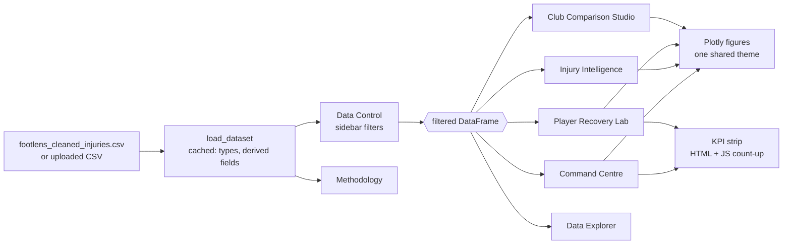

<div align="center">




**Decode player availability. Understand injury patterns. Reveal the performance signals hidden beneath every match.**

</div>


## ⚡ What is FootLens?

FootLens is a single-file **Streamlit** application that turns a football injury dataset into an interactive intelligence workspace. It answers questions such as:

- Which injuries keep players out the longest, and when do they cluster?
- Do player ratings look different before an injury and after the return?
- How do clubs compare on injury volume, recovery and results while a player is absent?
- What exactly is in the data, and how complete is it?

It is built for **descriptive exploration**. Nothing in it claims that an injury *caused* a change in results.


## 🚀 Quick start

```bash
# 1. clone / copy the project, then install dependencies
pip install -r requirements.txt

# 2. keep these two files side by side
#    app.py
#    footlens_cleaned_injuries.csv

# 3. launch
streamlit run app.py
```

Open the local URL Streamlit prints, enter a display name on the profile screen, and you are in. No password; the profile lives only in the browser session.

> **No CSV beside `app.py`?** Enter the workspace and use **Replace / upload dataset** in the sidebar.

Optional but recommended: add `.streamlit/config.toml` so tables and embedded components match the dark theme.

```toml
[theme]
base = "dark"
primaryColor = "#22d3ee"
backgroundColor = "#050912"
secondaryBackgroundColor = "#0a1428"
textColor = "#eaf2ff"
font = "sans serif"

[client]
toolbarMode = "minimal"
```


## 🧭 Six workspaces, one product


| Workspace | What you get |
|---|---|
| **Command Centre** | Count-up KPI cards, injury volume over time with a 3-month rolling average, injury-mix donut, recovery and rating-change distributions, club leaderboard, data-quality meters. |
| **Injury Intelligence** | Five tabs: treemap and category donut; stacked monthly bars and season-by-month / club-by-month heatmaps; position sunburst, age groups and an age-vs-recovery scatter; violin plots and recovery bands; team-impact charts. Includes page-level focus filters. |
| **Player Recovery Lab** | Searchable player profile with an abstract SVG avatar, FIFA rating ring, status glow, animated injury timeline, before/after rating dumbbell, recovery and rating-change charts, and the full injury history table. |
| **Club Comparison Studio** | Pick up to four clubs: side-by-side cards, a normalised radar, grouped bars, a rating dumbbell, an interactive ranking, and a comparison table. |
| **Data Explorer** | Quick search, column sets and visibility, sorting, two CSV downloads, completeness metrics, missing-value charts and dataset metadata. |
| **Methodology** | Plain-language definitions for every metric and derived field. |


## 🎛️ The Data Control panel (sidebar)

The sidebar filters are presented as a live control deck. They shape **every** workspace.

| Group | Filter | Widget key |
|---|---|---|
| Squad scope | Club | `filter_Team Name` |
| Squad scope | Season | `filter_Season` |
| Player & injury | Position | `filter_Position` |
| Player & injury | Injury | `filter_Injury` |
| Player & injury | Age range | `age_filter` |
| Timeline | Injury date range | `date_filter` |

- Each filter shows a state badge: **All** when untouched, or a glowing count (for example `3 of 8`) when narrowed.
- The header shows `ALL DATA` or `N ACTIVE`, with a segmented activity bar that lights one segment per narrowed filter.
- **Reset filters** clears all six; **Sign out / return to start** returns to the landing page.
- The active-filter display is read-only: it never alters the filtering logic.


## 📊 The data

<div align="center">

| Records | Players | Clubs | Seasons | Fields |
|:---:|:---:|:---:|:---:|:---:|
| **656** | **224** | **8** | **5** (2019/20 – 2023/24) | **53** |

</div>



*Coverage is computed from the bundled CSV. Missing values are never filled in: each chart uses only the records that have the fields it needs.*

### Columns FootLens relies on

`Name`, `Team Name`, `Position`, `Age`, `Season`, `Injury` are **required**. The app also uses, when present: `Date of Injury`, `Date of return`, `FIFA rating`, `Recovery_Days`, `Avg_Pre_Injury_Rating`, `Avg_Post_Injury_Rating`, `Performance_Change`, `Wins_During_Absence`, `Points_During_Absence`, `Avg_GD_During_Absence`, `Absence_Matches_Recorded`, plus the per-match `*_before_injury_GD` and `*_Player_rating` columns.

### Derived fields (added in memory, never written back to your CSV)

| Field | How it is made |
|---|---|
| `Avg_GD_Before_Injury` | Mean of the `*_before_injury_GD` columns |
| `Team_Performance_Drop` | `Avg_GD_Before_Injury − Avg_GD_During_Absence`. Positive means goal difference was lower during the absence |
| `Injury_Clean` | Trimmed, lower-cased, re-capitalised injury text, so "Knee injury" and "knee injury" count together |
| `Injury_Category` | Keyword rules over `Injury_Clean` (muscle, ligament & tendon, bone & fracture, illness, and so on). A grouping aid, not a medical classification |
| `Position_Group` | Goalkeeper, Defender, Midfielder or Forward, from the listed position |
| `Age_Group` / `Recovery_Band` | Fixed bins: ≤21, 22–25, 26–29, 30–33, 34+ and 1–7, 8–14, 15–28, 29–60, 61–120, 120+ days |
| `Points_Per_Absence_Match` | `Points_During_Absence ÷ Absence_Matches_Recorded` where at least one match was recorded |


## ⚙️ Behaviour worth knowing

- **Undated records.** 83 of the 656 records have no injury date. They stay in the data unless you narrow the date range; date-based charts simply leave them out. Set `KEEP_UNDATED_RECORDS = False` near the top of `app.py` to drop undated rows whenever the date filter is active, as an earlier version did.
- **Merged injury names.** The Injury filter and all injury charts use the merged `Injury_Clean` names.
- **Recovery is skewed.** A handful of very long layoffs stretch the scale, so recovery charts offer a log-scale toggle and the Command Centre histogram caps its axis at the 95th percentile (and says so).
- **Radar chart.** Axes are scaled 0–100 between the lowest and highest club, so different units can share one chart. Hover shows the real values.

## 🏗️ How it fits together



```
.
├── app.py                         # the entire application
├── footlens_cleaned_injuries.csv  # dataset (or upload in the sidebar)
├── requirements.txt
├── README.md
├── assets/                        # animated SVGs used by this README
└── .streamlit/
    └── config.toml                # optional dark theme
```

## 🎨 Design language

**Cybernetic Aurora × glassmorphism × tactile neumorphism.** Dark obsidian base, animated aurora and drifting particles drawn with CSS pseudo-elements, glass panels, inset controls, and glow reserved for hierarchy.



| Role | Font |
|---|---|
| Large headings | Space Grotesk |
| Titles and metrics | Manrope |
| Interface text | DM Sans |
| Labels, IDs, metadata | DM Mono |

**Motion, honestly.** Real JavaScript runs inside two isolated components: the count-up KPI strip and the landing-page hero (particle constellation, mouse parallax, animated pitch). Everything else is CSS. Streamlit components cannot control the parent page, so there is no scroll-driven JavaScript and no magnetic buttons. Scroll reveals use CSS scroll-driven animation and appear in Chrome and Edge; elsewhere content simply shows without the effect. All animation respects `prefers-reduced-motion`.

## 🧰 Troubleshooting

| Symptom | Fix |
|---|---|
| "Dataset not found" | Put `footlens_cleaned_injuries.csv` next to `app.py`, or upload it in the sidebar. |
| "Missing required columns" | Your file needs `Name`, `Team Name`, `Position`, `Age`, `Season`, `Injury`. |
| Flat instead of gradient area chart | Upgrade Plotly (`pip install -U plotly`); the gradient fill needs a recent version. |
| White box behind a KPI strip | Add the `.streamlit/config.toml` above so the theme is dark. |
| Sidebar nav icons or glow missing | Upgrade Streamlit; the styling relies on current `data-testid` hooks and the `:has()` selector. |
| No records shown | A filter combination is empty. Use **Reset filters**. |


<div align="center">

**FootLens** · *Beyond the game. Behind the numbers.*

<sub>Descriptive analytics · Missing data stays missing · Built with Streamlit, Plotly and pandas</sub>

</div>

# FootLens Analytics — Player Injuries & Team Performance

An interactive Streamlit dashboard exploring how player injuries relate to individual performance after recovery and club results during player absence.

## Dataset

The app is built around `footlens_cleaned_injuries.csv` (656 rows, 53 columns in the inspected version). Each row represents an injury record. The dataset includes player and club details, injury and return dates, match results and goal differences before/during/after an injury, recovery days, and pre-/post-injury ratings.

## Features

- Sidebar filters for club, season, position, injury type, and player age
- KPI cards for injury records, players, clubs, recovery time, and rating change
- Injury-type comparison using a derived team performance drop measure
- Monthly injury-frequency heatmap by club
- Player age vs. post-injury rating-change scatter plot
- Comeback leaderboard
- Club results during recorded player absences
- Player-level pre-/post-injury rating timeline
- Filtered-data explorer and CSV download

## Run locally

1. Keep `app.py`, `requirements.txt`, and `footlens_cleaned_injuries.csv` in the same folder.
2. Install dependencies:

   ```bash
   pip install -r requirements.txt
   ```

3. Start the app:

   ```bash
   streamlit run app.py
   ```

Alternatively, upload a CSV with the same column structure using the uploader in the app's sidebar.

## Deploy on Streamlit Community Cloud

1. Push `app.py`, `requirements.txt`, `README.md`, and `footlens_cleaned_injuries.csv` to a GitHub repository.
2. Open Streamlit Community Cloud and connect your GitHub account.
3. Select the repository, branch, and `app.py` as the main file.
4. Deploy. Add the live app URL to this README after deployment.

## Methodology and limitations

- `Performance_Change` is used as post-injury average player rating minus pre-injury average player rating.
- `Team_Performance_Drop` is engineered as average goal difference across the three recorded pre-injury matches minus average goal difference during recorded missed matches. A positive value means the team's average goal difference was lower during the absence period.
- Missing values are not fabricated; each chart uses the available records for its required fields.
- The dataset contains up to three match observations in each phase, so these metrics are descriptive and should not be treated as proof of causation or full-season team performance.
